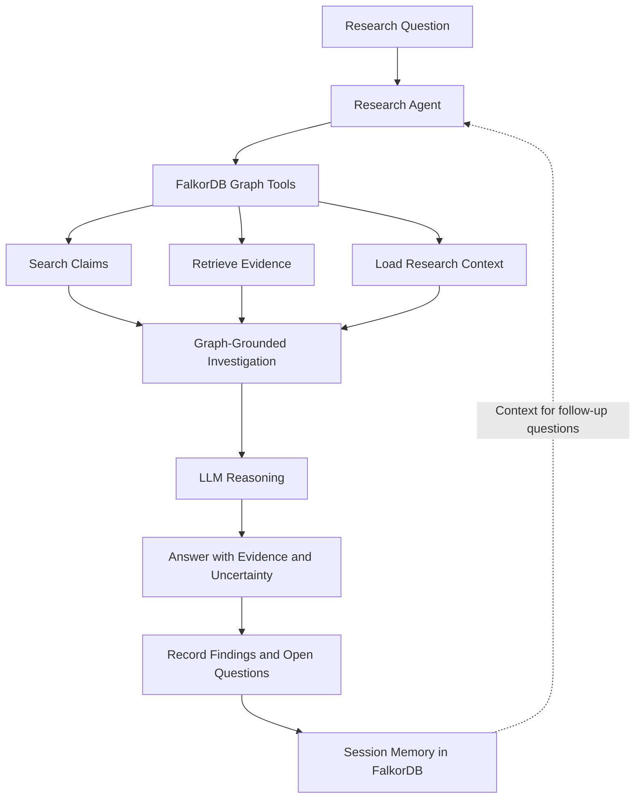

# ArxAgent — Graph-Grounded AI Research Agent

> **Research with evidence, not just answers.**

ArxAgent is a graph-grounded AI research agent that uses **FalkorDB as its research context layer** to retrieve claims, trace supporting evidence, identify gaps in existing knowledge, and maintain continuity across research sessions.

Instead of treating every question as an isolated LLM prompt, ArxAgent uses a structured knowledge graph to inform its investigation. The graph determines which claims and evidence are available to the agent, helping it distinguish documented findings from unanswered research questions.


## The Problem

Research agents can generate convincing explanations without making it clear where their conclusions come from. Relevant findings become difficult to track across papers, evidence can be disconnected from claims, and follow-up investigations may lose their context.

ArxAgent addresses this problem by combining graph-based knowledge retrieval, evidence-grounded answering, and session memory.


## SETUP
To set up this project, please follow through the link below or navigate to SETUP.md.

[SETUP](https://github.com/AlgoBrother/ArxAgent/blob/main/SETUP.md)


## How ArxAgent Works



### The Graph Is Part of the Decision Process

FalkorDB provides the structured research context used during investigation.

- **Claim retrieval:** Find relevant claims stored in the knowledge graph.
- **Evidence lookup:** Retrieve supporting evidence and its associated paper information.
- **Knowledge-gap identification:** Determine when the current graph lacks evidence for a requested comparison or conclusion.
- **Research continuity:** Store findings and open questions so subsequent investigations can build on previous work.

The LLM reasons over the retrieved context; it does not replace the graph as the source of stored research knowledge.

## Key Features

### 1. Graph-Grounded Research

ArxAgent searches stored research claims and retrieves associated evidence before constructing an answer.

### 2. Evidence-Aware Answers

The agent distinguishes between what the stored evidence supports, what remains uncertain, and what the graph cannot establish.

### 3. Knowledge-Gap Detection

When the graph does not contain evidence for a requested topic, the agent can explicitly report that limitation instead of presenting missing information as established fact.

Importantly, a gap in the current graph does not mean the broader scientific literature lacks the answer.

### 4. Persistent Research Sessions

ArxAgent integrates session memory with FalkorDB to preserve research findings and unresolved questions. Follow-up investigations can retrieve earlier context rather than starting entirely from scratch.

### 5. Structured Paper Knowledge

The research pipeline processes scientific papers into structured claims and evidence, enabling graph-based retrieval rather than relying exclusively on unstructured document search.

## Technology Stack

- **Language:** Python
- **Graph database:** FalkorDB
- **LLM integration:** Groq API
- **Model used in testing:** `qwen/qwen3.8-27b`
- **Research pipeline:** PDF extraction, chunking, structured claim extraction, and evidence validation
- **Data validation:** JSON Schema and evidence-integrity checks
- **Backend:** FastAPI / Uvicorn, where configured
- **Frontend:** Next.js, React, and TypeScript
- **Session memory:** Custom Python integration with FalkorDB

## Architecture

ArxAgent separates the research pipeline from the runtime research agent.

| Component | Responsibility |
|---|---|
| Paper processing | Extract and prepare scientific paper content |
| Claim extraction | Convert paper content into structured research knowledge |
| Evidence validation | Validate extracted data against schemas and evidence-integrity checks |
| FalkorDB | Store and retrieve the research graph and session context |
| Graph tools | Expose controlled graph-search and evidence-retrieval operations |
| Research agent | Coordinate investigation and reason over retrieved context |
| Session memory | Preserve research findings and open questions |
| Frontend | Provide an interface for interacting with the agent |

## Example Investigation

**Research question:** How does DEEPNORM stabilize very deep Transformers, and what evidence supports it?

The agent can investigate the stored graph, retrieve a relevant claim, and locate its associated evidence.

In a local-only test, the graph tools successfully retrieved the stored claim `P20_C0000_CLAIM_001`, associated with the paper *DeepNet: Scaling Transformers to 1,000 Layers*. The test also verified that unknown tools and unexpected arguments were rejected.

The current graph is a small, curated research knowledge base, so answers are explicitly limited to the evidence available in it.

## Session Memory in Action

ArxAgent is designed to support multi-step research.

1. Ask a research question.
2. Retrieve relevant claims and evidence.
3. Record a finding and an unresolved question in the research session.
4. Ask a follow-up question using the same session.
5. Retrieve the previous research context and continue the investigation.

For example:

**Initial question:** How does DEEPNORM stabilize very deep Transformers?

**Follow-up:** What experimental evidence compares DEEPNORM with alternative normalization methods?

The follow-up should use the recorded research context and retrieve relevant graph evidence before drawing conclusions.

## Getting Started

### Prerequisites

- Python and a virtual environment
- Node.js and npm, if running the frontend
- Docker, for a local FalkorDB instance
- A Groq API key for LLM-powered investigations

### 1. Clone the Repository

```bash
git clone <YOUR_PUBLIC_GITHUB_REPOSITORY_URL>
cd arxagent_paper_pipeline
```

### 2. Configure Python

Create and activate a virtual environment, then install the project's dependencies.

```bash
python -m venv .venv
source .venv/bin/activate
pip install -r requirements.txt
```

Use the dependency file and Python version configured for your project if they differ from these defaults.

### 3. Configure Environment Variables

Create a local `.env` file containing the required configuration, including the Groq API key, FalkorDB connection settings, and backend authentication secret where applicable.

Never commit `.env`, frontend secret files, or API credentials to a public repository.

### 4. Start FalkorDB

For a local development instance:

```bash
docker run -d \
  --name arxagent-falkordb \
  -p 6379:6379 \
  -p 3000:3000 \
  falkordb/falkordb:latest
```

**Data persistence:** Configure a persistent volume or use a managed database before relying on this container for durable storage. Ensure the agent's connection settings point to the intended graph database.

Do not run this command if you already have a FalkorDB container containing the graph you intend to use.

### 5. Run the Local-Only Test

From the repository root:

```bash
python -m scripts.research_agent --local-test
```

This test exercises the graph tools without making LLM/API calls.

The validated local test completed with 135 graph nodes, 143 edges, successful evidence retrieval, and checks rejecting unknown tools and unexpected arguments. Counts may differ as the graph changes.

### 6. Run the Application

Start the backend and frontend using the entry points and commands configured in your deployment setup.

The backend requires its environment variables and access to FalkorDB. The frontend requires its server-side API URL and backend authentication configuration.

## Demo

The demonstration should show the actual application running, not just slides.

1. Ask a research question with a known claim in the graph.
2. Show the investigation trace and supporting evidence.
3. Ask a question that the current graph cannot answer completely.
4. Show the agent acknowledging the limitation of its evidence base.
5. Continue an existing research session and verify that the previous finding and open question are recalled.

The demo should make it clear which conclusions came from stored graph evidence and which questions remain unresolved.

**Demo video:** [Insert public demo video URL]

**Live application:** [Insert deployed application URL]

## Current Limitations

- The current knowledge graph is a small, curated collection of research papers, not an exhaustive scientific database.
- Answer quality and coverage depend on the claims and evidence successfully ingested into the graph.
- Missing evidence in the graph should not be interpreted as proof that no evidence exists in the literature.
- Persistent session recall and deployed graph connectivity should be verified in the target environment before being presented as production-ready capabilities.

## Why FalkorDB?

FalkorDB serves as the structured context layer connecting research claims, evidence, and session knowledge. Its role is operational: the agent queries the graph to determine which stored findings and evidence can inform an investigation.

This makes the graph part of the research workflow rather than a passive database attached to an otherwise independent chatbot.


**The goal:** an agent that can explain not only what it concludes, but also what its stored evidence supports, what remains unknown, and where the next investigation should begin.
