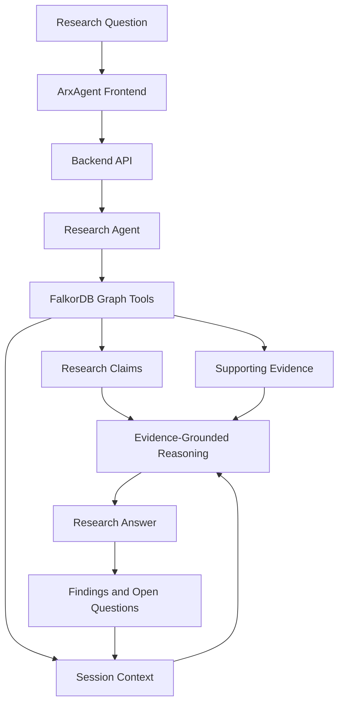

# ArxAgent — Complete Setup Guide

ArxAgent is a graph-grounded AI research agent built around FalkorDB. It retrieves research claims and supporting evidence, uses graph context to guide investigations, and maintains research-session context to help identify unresolved questions.

This guide explains how to run ArxAgent locally, populate its knowledge graph, validate graph operations, and launch the application.

**Repository:** https://github.com/AlgoBrother/ArxAgent

## 1. Prerequisites

Install the following software:

| Requirement | Purpose |
|---|---|
| Python 3.12 | Backend and research pipeline |
| Git | Clone the repository |
| Docker | Run FalkorDB locally |
| Node.js and npm | Frontend development |
| Groq API key | LLM-powered research |

Docker must be running before starting the database.

## 2. Clone the repository

```bash
git clone https://github.com/AlgoBrother/ArxAgent.git
cd ArxAgent
```

Create and activate a virtual environment:

```bash
python3.12 -m venv .venv
source .venv/bin/activate
```

On Windows PowerShell, activate it with:

```powershell
.venv\Scripts\Activate.ps1
```

Upgrade pip and install the backend dependencies:

```bash
python -m pip install --upgrade pip
pip install -r requirements.txt
```

Run subsequent Python commands from the repository root with the virtual environment activated.

## 3. Start FalkorDB

ArxAgent uses FalkorDB as its graph-backed context store.

Start a local instance:

```bash
docker run -d \
  --name arxagent-falkordb \
  -p 6379:6379 \
  -p 3000:3000 \
  -v arxagent-falkordb-data:/var/lib/falkordb/data \
  falkordb/falkordb:latest
```

The named Docker volume is intended to preserve database files across container recreation.

Check the container status:

```bash
docker ps
docker logs arxagent-falkordb
```

The default connection settings are:

```text
Host: localhost
Port: 6379
```

If the container already exists, restart it rather than creating a second container with the same name:

```bash
docker start arxagent-falkordb
```

If port `6379` is already occupied, stop the conflicting service or configure a different host port and update the database connection settings accordingly.

The FalkorDB browser interface is commonly available at `http://localhost:3000` when exposed by the selected image.

## 4. Configure environment variables

Create a `.env` file in the repository root.

```dotenv
GROQ_API_KEY=your_groq_api_key
FALKORDB_HOST=localhost
FALKORDB_PORT=6379
ARXAGENT_BACKEND_SECRET=replace_with_a_long_random_secret
```

Use real values locally. Never commit API keys, passwords, or secrets to GitHub.

The main settings are:

| Variable | Purpose |
|---|---|
| `GROQ_API_KEY` | Enables LLM-powered research requests |
| `FALKORDB_HOST` | FalkorDB hostname |
| `FALKORDB_PORT` | FalkorDB port |
| `FALKORDB_PASSWORD` | Optional database password, if authentication is configured |
| `ARXAGENT_BACKEND_SECRET` | Shared secret used to protect backend endpoints |

The backend authentication secret is separate from the Groq API key.

For a local database without authentication, omit `FALKORDB_PASSWORD`.

## 5. Prepare the research knowledge

The knowledge graph is populated from structured research knowledge; starting FalkorDB alone creates no ArxAgent research dataset.

The repository's paper-processing workflow includes scripts for extracting PDFs, creating chunks, resolving downloads, validating knowledge, and ingesting structured knowledge into FalkorDB.

The general pipeline is:

1. Obtain the research papers listed in the project's bibliography.
2. Extract text and create chunks.
3. Generate structured research knowledge from the relevant chunks.
4. Validate the extracted knowledge.
5. Ingest the validated knowledge into FalkorDB.

The `data/knowledge/by_chunk/` directory is used by the graph-ingestion workflow for structured knowledge files.

If these files are already included in your checkout, proceed to ingestion. If they are absent, run the applicable paper-processing and extraction stages first. Extraction and chunking alone do not guarantee that structured claims and evidence have been generated.

## 6. Build the knowledge graph in FalkorDB

From the repository root, ensure your virtual environment is active and the database connection settings are configured.

The graph-ingestion implementation is located at:

```text
scripts/graph/ingest_falkordb.py
```

Inspect the script's supported options:

```bash
python scripts/graph/ingest_falkordb.py --help
```

If the script does not expose a help option, inspect its argument parser and configuration at the top of the file.

Run the ingestion command using the options supported by the checked-out version of the script. Ensure the input directory points to the structured knowledge files and that the graph name matches the one expected by ArxAgent.

The graph name used in the project's research workflow is `LLMStability`.

After ingestion, inspect the command output for successful writes and any skipped or rejected records. Do not assume the graph is populated simply because the script exits.

**Important:** Ingestion must target the same FalkorDB instance that the backend will query. For local development, that is normally `localhost:6379`. For a deployed backend, configure ingestion to use the intended database's private hostname and port.

Run ingestion when initializing or updating the dataset, not automatically on every backend startup.

## 7. Validate the graph tools

From the repository root, run:

```bash
python -m scripts.research_agent --local-test
```

This exercises the graph-tool workflow without making LLM/API calls.

A previous validated local run reported:

- 135 graph nodes
- 143 graph relationships
- Successful retrieval of a stored research claim
- Successful supporting-evidence lookup
- Rejection of unknown tools and unexpected arguments

These are historical test results, not guaranteed counts for a newly initialized database.

If the test fails, verify that FalkorDB is running, the environment variables point to the intended instance, and the required knowledge has been ingested.

## 8. Launch the backend API

The backend entry point is `api.py`.

From the repository root, start the FastAPI application:

```bash
uvicorn api:app --host 0.0.0.0 --port 8000
```

The API will listen on:

```text
http://localhost:8000
```

If the application exposes FastAPI's OpenAPI interface, you can inspect it at:

```text
http://localhost:8000/docs
```

The backend uses the configured authentication secret for protected endpoints. Requests to protected routes must supply the authentication format expected by the API.

Keep the backend terminal running while using the frontend.

## 9. Launch the frontend

Open a second terminal in the repository.

Install the frontend dependencies:

```bash
cd arxagent-ui
npm install
```

Create `arxagent-ui/.env.local` using the environment-variable names expected by the frontend's API proxy. Configure the backend URL and the shared backend authentication secret. Keep these values server-side and do not expose the secret through a `NEXT_PUBLIC_*` variable.

Start the frontend in development mode:

```bash
npm run dev
```

Open the URL printed by Next.js, normally:

```text
http://localhost:3000
```

If FalkorDB's browser interface already occupies port `3000`, run the frontend on another port:

```bash
npm run dev -- --port 3001
```

The frontend must be able to reach the backend through its configured API proxy.

## 10. Test a research investigation

Once the graph is populated and the application is running, try this research question:

> How does DEEPNORM stabilize very deep Transformers, and what evidence supports it?

Check whether ArxAgent can retrieve the relevant claims and supporting evidence from FalkorDB.

Then ask a follow-up:

> What experimental evidence compares DEEPNORM with alternative normalization methods?

A useful investigation should distinguish between evidence already present in the graph and information that remains unresolved. Missing evidence in the graph should not be treated as proof that no such evidence exists.

For session-memory testing, continue the investigation using the same research session and verify that the earlier findings and open question are recalled.

## 11. Troubleshooting

### FalkorDB connection errors

- Check that the container is running with `docker ps`.
- Review the container logs with `docker logs arxagent-falkordb`.
- Verify `FALKORDB_HOST` and `FALKORDB_PORT`.
- Ensure the backend and ingestion script use the same database.

### Empty graph or missing research results

- Confirm the structured knowledge files exist.
- Run the graph-ingestion workflow.
- Check its output for skipped or rejected records.
- Verify that the application is querying the expected graph.

### Missing API key

- Check the root `.env` file.
- Confirm the application loads it or that the variables are exported in the shell.
- Do not commit the file.

### Frontend cannot reach the backend

- Verify that the backend process is running.
- Check the backend URL configured in the frontend's API proxy.
- Confirm that the backend authentication secret matches on both sides.
- Inspect the frontend and backend logs for errors.

### Port conflicts

Check which process is using the relevant port and change the host port or application port if necessary.

## Architecture



## Limitations and reproducibility

ArxAgent's answers depend on the quality and coverage of the structured research knowledge loaded into FalkorDB. A successful local graph-tool test does not, by itself, establish that every paper has been processed or that the complete application is deployed.

For reproducible results, record the knowledge dataset used, the graph name, the ingestion output, and the research question tested.

## Project

**Repository:** https://github.com/AlgoBrother/ArxAgent

ArxAgent explores how a graph can actively guide a research agent's retrieval, evidence tracing, and continuity across investigations, rather than serving only as a passive storage layer.
